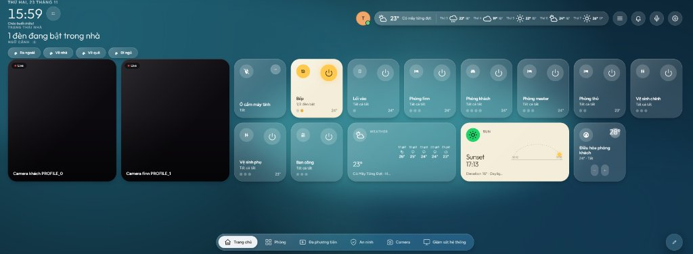
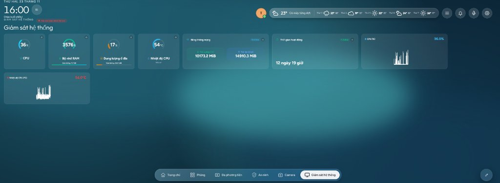
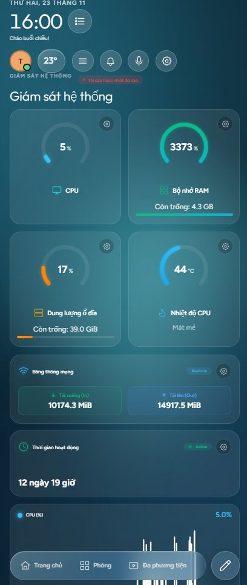
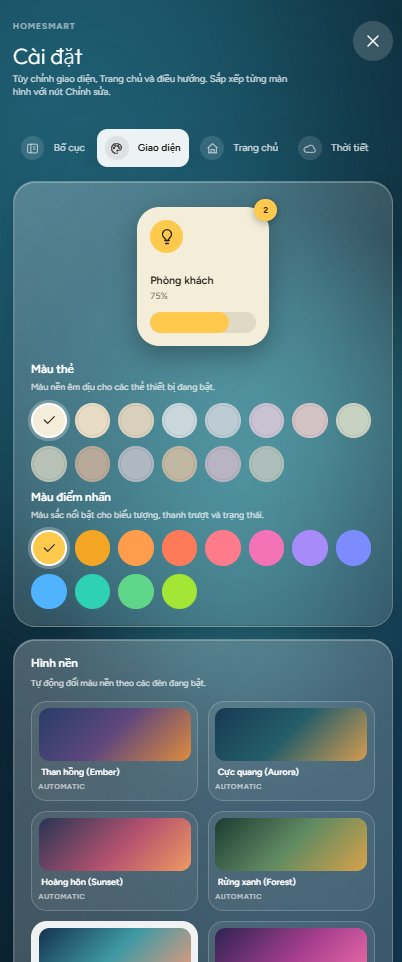
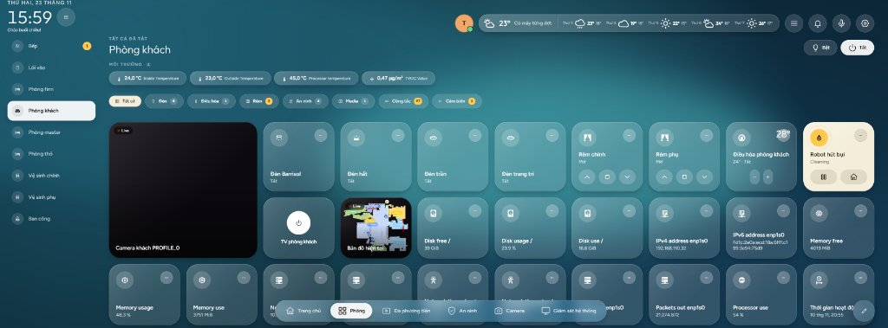

# HomeSmart 🏠✨

> **Commercial-Grade, Zero-YAML Smart Home Dashboard for Home Assistant**  
> *Modern Glassmorphic & Cyber Bento UI — 100% Free & Open-Source.*

---

  
   
  <em>Giao diện Trang chủ HomeSmart với bố cục Bento Grid kính mờ và thanh ngữ cảnh tự thích ứng / HomeSmart Bento Grid Main Dashboard</em>

---

  <b>Language / Ngôn ngữ:</b> 
  <a href="#-tiếng-việt">🇻🇳 <b>Tiếng Việt</b></a> &nbsp;|&nbsp; <a href="#-english">🇬🇧 <b>English</b></a>

---

## 🇻🇳 Tiếng Việt

**HomeSmart** (`domain: homesmart`) là bảng điều khiển (Dashboard Custom Panel) thế hệ mới độc lập dành cho **Home Assistant**, được thiết kế tối ưu chuyên sâu cho **máy tính bảng gắn tường (Wall Panel)**, **điện thoại di động**, **màn hình cảm ứng** và **máy tính Desktop**.

HomeSmart kết hợp giữa thiết kế **Bento Grid kính mờ (Glassmorphism & Cyber Glow)**, hiệu ứng chuyển động cảm ứng mượt mà, cùng khả năng **tự động nhận diện thiết bị (Zero-YAML)** – hoàn toàn không cần cấu hình file YAML phức tạp, không giới hạn phòng hay số lượng thiết bị.

---

### 🌟 Các Tính Năng Nổi Bật (Phiên bản v1.6.2)

#### 1. 🚀 Nhận diện tự động thông minh (Zero-YAML Engine)
- Tự động đồng bộ các khu vực (`areas`), thiết bị (`devices`), thực thể (`entities`) và trạng thái (`states`) từ Home Assistant.
- Tự phân chia thiết bị về đúng các phòng (*Phòng khách, Phòng ngủ, Bếp, Sân vườn, An ninh...*) mà không cần người dùng can thiệp thủ công.
- Tự động chọn kích thước thẻ Bento phù hợp theo tính năng: công tắc đèn, chiết áp, rèm cửa, điều hòa, camera...

#### 2. 🖥️ Trang Giám Sát Hệ Thống Độc Lập (System Monitor)
- **Đồng hồ đo Cyber Glow Gauges**: Theo dõi trực quan tải CPU, bộ nhớ RAM, dung lượng ổ đĩa, nhiệt độ chip, băng thông mạng (Tải xuống / Tải lên) và thời gian hoạt động (Uptime).
- **Biểu đồ lịch sử 24 giờ**: Trực quan hóa đường cong dao động tải và nhiệt độ trong 24h qua.
- **Tùy biến chọn cảm biến linh hoạt**: Tự động gợi ý và cho phép bạn tự gán bất kỳ sensor nào trong Home Assistant vào các thẻ đo chỉ với 1 chạm.

  
   
  <em>Màn hình Giám sát hệ thống trên Desktop với đồng hồ Cyber Glow và biểu đồ dao động 24h</em>

  
  &nbsp;
  
   
  <em>Giao diện Giám sát hệ thống trên điện thoại (trái) và Cài đặt giao diện màu sắc kính mờ (phải)</em>

#### 3. ⚡ Sơ Đồ Năng Lượng Động & Biểu Giá Điện EVN 5 Bậc Mới
- **Sơ đồ luồng điện động (Animated Power Flow)**: Trực quan hóa chuyển động của dòng năng lượng giữa Điện mặt trời (Solar) ➔ Tiêu thụ trong nhà (Home) ➔ Lưới điện (EVN) theo thời gian thực.
- **Tính toán tiền điện EVN 5 bậc mới**: Tự động chia bậc lũy tiến và ước tính chi phí tiền điện sinh hoạt hàng tháng theo biểu giá mới nhất:
  - Bậc 1 (0 – 100 kWh): 1.901 đ/kWh
  - Bậc 2 (101 – 200 kWh): 2.289 đ/kWh
  - Bậc 3 (201 – 400 kWh): 2.894 đ/kWh
  - Bậc 4 (401 – 700 kWh): 3.456 đ/kWh
  - Bậc 5 (Từ 701 kWh trở lên): 3.844 đ/kWh

#### 4. 🧠 Thanh Ngữ Cảnh Tự Động & Trợ Lý Giọng Nói (Assist Voice)
- **Lời chào thích ứng theo khung giờ**: Tự động hiển thị lời chào phù hợp (*Chào buổi sáng, Chào buổi chiều, Chào buổi tối, Chúc ngủ ngon*).
- **Cảnh báo thời tiết & an ninh**: Tự động hiển thị khi trời đang mưa hoặc khi tất cả thành viên trong gia đình đều vắng nhà.
- **Nút Micro kích hoạt HA Assist**: Chạm vào biểu tượng micro trên thanh tiêu đề để mở nhanh giao diện đàm thoại và điều khiển nhà bằng giọng nói tiếng Việt của Home Assistant.

#### 5. 📱 Tính Năng Siêu Cấp Cho Máy Tính Bảng Gắn Tường (Kiosk Mode)
- **Tự động thức dậy thông minh (Smart Presence Wake)**: Màn hình tự bật sáng mượt mà khi phát hiện có người đến gần thông qua radar hiện diện mmWave hoặc camera máy tính bảng.
- **Bảo vệ tuổi thọ pin (Battery Health Guard)**: Tự động ngắt sạc khi pin đạt 80% và bật sạc lại khi pin xuống dưới 20% thông qua ổ cắm thông minh, chống chai pin và phồng pin khi gắn tường 24/7.
- **Màn hình chờ OLED chống lưu ảnh (Anti-Burn-In Screensaver)**: Nền đen tuyền tiết kiệm điện, hiển thị đồng hồ, thời tiết, trình chiếu ảnh gia đình hoặc Spotify Canvas, tự động đổi vị trí pixel mỗi 60 giây để bảo vệ màn hình OLED.

#### 6. 🔔 Chuông Cửa Video WebRTC & Mở Cổng Nhanh
- Tự động bật sáng và hiển thị popup video chuông cửa tức thì chuẩn WebRTC (không bị trễ 2–5 giây như HLS).
- Tích hợp nút hành động trực tiếp trên màn hình: Mở cổng tức thì, bật đèn sân đón khách, đàm thoại 2 chiều.

#### 7. 🔄 Quản Lý Phiên Bản Ngay Trong Giao Diện (In-App Version Manager)
- Xem danh sách toàn bộ các phiên bản phát hành trên GitHub.
- Cho phép người dùng chuyển đổi, nâng cấp hoặc quay về bất kỳ phiên bản nào theo ý muốn trực tiếp từ trang Cài đặt.

#### 8. 🍱 Đa Dạng Bố Cục (Layouts) & Chế Độ Trẻ Em (Kids Mode)
- Hỗ trợ nhiều phong cách giao diện: **Tự động thích ứng (Auto)**, **Thanh bên (Sidebar)**, **Tập trung (Focus)**, **Bento Grid**, **Ảnh nền (Photo)**, **Danh sách (List)**.
- **Chế độ Trẻ Em**: Giao diện hoạt hình vui tươi với các hình nền cổ tích, chỉ hiển thị thiết bị phòng bé và khóa các khu vực nhạy cảm.
- **Bảo vệ bằng mã PIN 4 số**: Khóa an toàn cho cửa cuốn, khóa thông minh, bình nóng lạnh và trang Cài đặt.

  
   
  <em>Giao diện điều khiển theo phòng với danh mục thiết bị, camera trực tiếp và bản đồ robot hút bụi</em>

---

### 📥 Hướng Dẫn Cài Đặt

#### Cách 1: Cài đặt qua HACS (Khuyên dùng)
1. Mở Home Assistant ➔ Vào mục **HACS**.
2. Chọn **Integrations** (Tích hợp) ➔ Bấm vào **dấu 3 chấm (`⋮`)** ở góc trên bên phải ➔ Chọn **Custom repositories** (Kho lưu trữ tùy chỉnh).
3. Dán địa chỉ kho lưu trữ: `https://github.com/mrtlcs/HomeSmart`.
4. Loại (Category): Chọn **Integration**. Bấm **Add** (Thêm).
5. Tìm kiếm **HomeSmart**, bấm **Download** (Tải xuống) phiên bản mới nhất, sau đó **Khởi động lại Home Assistant**.
6. Vào **Cài đặt** ➔ **Thiết bị & Dịch vụ** ➔ **Thêm tích hợp** ➔ Tìm **HomeSmart** để kích hoạt. Bảng điều khiển HomeSmart sẽ xuất hiện ngay trên thanh menu bên trái!

#### Cách 2: Cài đặt thủ công (Manual)
1. Tải file `homesmart.zip` từ trang [Releases](https://github.com/mrtlcs/HomeSmart/releases).
2. Giải nén và sao chép thư mục `custom_components/homesmart` vào thư mục `<config>/custom_components/` của Home Assistant.
3. Khởi động lại Home Assistant.
4. Vào **Cài đặt** ➔ **Thiết bị & Dịch vụ** ➔ **Thêm tích hợp** ➔ Tìm **HomeSmart**.

---

 

 

## 🇬🇧 English

**HomeSmart** (`domain: homesmart`) is a commercial-grade, standalone dashboard custom panel integration for **Home Assistant**, engineered specifically for **wall-mounted tablets**, **smartphones**, **touchscreens**, and **desktop command centers**.

It brings together a modern **Glassmorphic Cyber Bento Grid** aesthetic, 60–120 FPS tactile touch response, and a powerful **Zero-YAML auto-discovery engine** — requiring zero YAML configuration, zero subscription paywalls, and supporting unlimited rooms and devices.

---

### 🌟 Key Highlights (Version v1.6.2)

#### 1. 🚀 Zero-YAML Auto-Discovery Engine
- Instantly connects to Home Assistant's `areas`, `devices`, `entities`, and `states`.
- Automatically organizes devices into their respective rooms (*Living Room, Bedroom, Kitchen, Garden, Security...*).
- Selects optimal Bento tile dimensions based on entity capabilities (toggles, sliders, climate dials, camera feeds).

#### 2. 🖥️ Dedicated System Monitor Dashboard
- **Cyber Glow Gauges**: Visual telemetry cards for CPU usage, RAM memory, storage disk capacity, CPU/SoC temperature, network throughput (Download/Upload), and system uptime.
- **24-Hour Interactive Sparklines**: Historical trend charts for vital load and temperature fluctuations.
- **Custom Sensor Assignment**: Intelligent auto-detection ranked suggestions with a 1-tap modal to assign custom sensors for each vital metric.

  
   
  <em>HomeSmart System Monitor on Desktop with Cyber Glow gauges and 24h history sparklines</em>

  
  &nbsp;
  
   
  <em>System Monitor mobile view (left) and Glassmorphic Theme Customizer (right)</em>

#### 3. ⚡ Animated Power Flow & Vietnam EVN 5-Tier Energy Calculator
- **Live Animated Power Flow**: Dynamic real-time SVG dashed-flow animation showing energy distribution between Solar ➔ Home ➔ Grid (reversing direction during grid export).
- **Vietnam EVN 5-Tier Electricity Calculation**: Progressive tier calculation and monthly bill estimation based on Vietnam's official 5-tier residential tariff structure:
  - Tier 1 (0 – 100 kWh): 1,901 VND/kWh
  - Tier 2 (101 – 200 kWh): 2,289 VND/kWh
  - Tier 3 (201 – 400 kWh): 2,894 VND/kWh
  - Tier 4 (401 – 700 kWh): 3,456 VND/kWh
  - Tier 5 (Over 700 kWh): 3,844 VND/kWh

#### 4. 🧠 Dynamic Context Header & Assist Voice Control
- **Context-Aware Greetings**: Automatically adapts greeting messages to the current time of day (*Good morning, Good afternoon, Good evening, Good night*).
- **Live Environmental & Presence Alerts**: Displays live rainfall alerts and updates when all family members are away from home.
- **Built-in Voice Assistant (Assist)**: Quick-access microphone button in the header triggering Home Assistant's native Assist voice pipeline.

#### 5. 📱 Wall Tablet & Kiosk Superpowers
- **Smart Presence Wake**: Automatically fades the screen on when mmWave radar sensors (e.g. LD2410, Aqara FP2) or tablet cameras detect a person approaching within 1.5m.
- **Battery Health Guard**: Monitors battery levels via Fully Kiosk or HA Companion App, cycling a smart charger between 20% and 80% to prevent battery swelling for 24/7 wall tablets.
- **Anti-Burn-In OLED Screensaver**: Power-saving pure black `#000000` canvas with floating clock, weather, family photo slideshow, and Spotify Canvas with periodic 60-second pixel shifting.

#### 6. 🔔 Zero-Latency WebRTC Video Doorbell Popup
- Instant popup video feed when doorbell rings or motion is detected, utilizing WebRTC for real-time video without 2–5 second HLS latency.
- Direct interactive action buttons: Unlock gate, turn on porch lights, and 2-way audio intercom.

#### 7. 🔄 In-App Version Manager
- Browse all GitHub releases directly inside HomeSmart settings.
- Upgrade, switch, or roll back across any release with one click.

#### 8. 🍱 Multi-Layouts, Themes & Security Protection
- **6 Adaptive Layout Modes**: Auto-Responsive, Sidebar, Focus, Bento Grid, Photo Background, List, and Kids Mode.
- **4-Digit PIN Security**: Lock sensitive hardware (gates, roller shutters, heaters, and configuration menu) from unauthorized access or accidental taps.
- **100% Bilingual**: Native Vietnamese (`vi`) and English (`en`) localization.

  
   
  <em>Room focus view with entity filters, live camera stream, and interactive robot vacuum map</em>

---

### 📥 Installation Guide

#### Method 1: Via HACS (Recommended)
1. Open **HACS** in your Home Assistant sidebar.
2. Go to **Integrations** ➔ Click the **three dots (`⋮`)** in the upper right ➔ Select **Custom repositories**.
3. Add Repository URL: `https://github.com/mrtlcs/HomeSmart`.
4. Category: **Integration**. Click **Add**.
5. Search for **HomeSmart**, click **Download** to get the latest release, then **Restart Home Assistant**.
6. Go to **Settings** ➔ **Devices & Services** ➔ **Add Integration** ➔ Search **HomeSmart**. The HomeSmart panel will appear in your sidebar!

#### Method 2: Manual Installation
1. Download `homesmart.zip` from [GitHub Releases](https://github.com/mrtlcs/HomeSmart/releases).
2. Extract and copy the `custom_components/homesmart` directory into your Home Assistant `<config_dir>/custom_components/`.
3. Restart Home Assistant.
4. Go to **Settings** ➔ **Devices & Services** ➔ **Add Integration** ➔ Search **HomeSmart**.

---

## 🛠️ Tech Stack & Architecture

- **Frontend**: React 19, TypeScript, Vite, CSS Modules / Glassmorphism.
- **Backend / Integration**: Python 3.12+, Home Assistant Custom Component (`domain: homesmart`), WebSocket API, Local Storage persistence.
- **Design Philosophy**: High performance, zero YAML configuration, tactile feedback, OLED battery preservation.

---

## 📄 License

This project is open-source and licensed under the **MIT License**. Free for personal and commercial smart home deployments.
