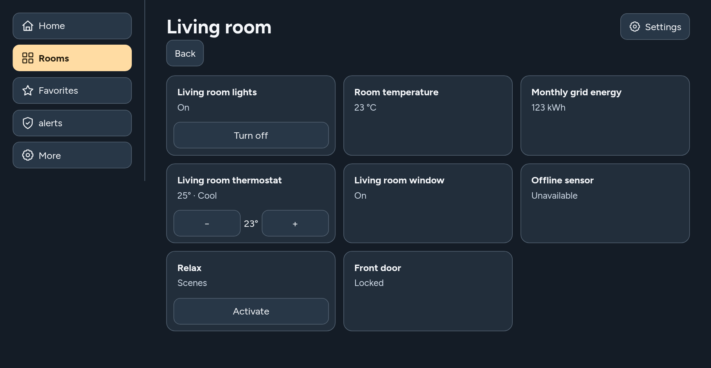

# HomeSmart for Home Assistant

**English** · [Tiếng Việt](README.vi.md)

HomeSmart adds a dashboard to your Home Assistant sidebar. It uses the areas and devices you already have in Home Assistant, so you can choose rooms, pin favorite devices and set up controls without writing dashboard YAML.

**HomeSmart v2.2.5** introduces screen profiles. You can keep the Classic dashboard on your desktop, put quick controls on your phone and use a remote on your TV, all with the same account. Requires **Home Assistant 2024.7.0 or newer**. [Release notes](https://github.com/mrtlcs/HomeSmart/releases/tag/v2.2.5) · [Latest release](https://github.com/mrtlcs/HomeSmart/releases/latest)



*Desktop profile in v2.2.5, shown with sample devices.* [See the same home on a phone](images/adaptive-phone-en.png)

## Install or update

### Install with HACS

1. Open **HACS → ⋮ → Custom repositories**. Add `https://github.com/mrtlcs/HomeSmart` and select **Integration** as the category.
2. Find **HomeSmart** in HACS, select **Download**, then restart Home Assistant.
3. Open **Settings → Devices & services → Add integration**, select **HomeSmart** and confirm.
4. Open **HomeSmart** in the sidebar. On first use, follow the setup to choose the rooms you want to see.

### Install manually

1. Download **homesmart.zip** from the release assets. [Download the latest package](https://github.com/mrtlcs/HomeSmart/releases/latest/download/homesmart.zip)
2. Extract the **entire archive** into `<config>/custom_components/homesmart/`. You should see `manifest.json` directly inside that folder, alongside `frontend/`. Keep the full frontend directory, including `chunks/` and `fonts/`.
3. Restart Home Assistant, then add **HomeSmart** under **Settings → Devices & services → Add integration**.

**Already using HomeSmart?** Update through HACS, or replace the installed integration files with the contents of the new release archive, then restart Home Assistant and reload the panel. An existing setup opens in Classic until you choose a screen profile. HomeSmart’s version list links to the corresponding GitHub releases.

## Choose a screen profile

In **HomeSmart → Settings → This device → Profile on this screen**, choose how this browser should display the dashboard.

| Profile | What you see |
| --- | --- |
| Phone | Bottom navigation and quick controls. Tap a device name to open its details. |
| Wall tablet | A dashboard with a clock. Set an idle timeout for the standby clock and quiet hours for a dimmer palette. |
| Desktop | Sidebar navigation, a grid of devices and a side panel for device details. |
| TV with remote | Large controls with a visible focus outline. Use the arrow keys to move, OK/Enter to select and Back to return on compatible remotes. Select this profile explicitly. |
| Automatic | Chooses Phone, Wall tablet or Desktop using the available panel width and input type. |
| Classic dashboard | Opens your existing layout, including Bento, Photo, List or Kids layouts. |

The choice on this browser takes priority over the account default, followed by the household default. Choose **Use inherited profile** to follow those defaults. Home Assistant administrators can also choose which tabs each adaptive profile shows, its starting tab and its card density.

## Everyday controls

- **Home and Rooms.** On Home, use favorites and quick controls to switch a light, adjust a thermostat or run a scene. Open Rooms to find a device by location. The dashboard shows when Home Assistant accepts a command or reports a failure.
- **Alerts and connection status.** Alerts separates security events, such as an open window, from unavailable devices. Open **More** to check the connection to Home Assistant, see the last dashboard sync or refresh the data.
- **Specialized views.** On Phone, Wall tablet and Desktop, **More** also opens enabled pages such as cameras, media, the floor plan, System Monitor and custom tabs. Choose **Classic dashboard** for the full Classic layout. [Classic home](images/home-dashboard.jpg) · [System Monitor](images/system-monitor-desktop.jpg)
- **Electricity costs.** For a bill estimate, set a flat or tiered tariff and choose a sensor that measures electricity **imported from the grid during the billing period**. A monthly Home Assistant Utility Meter in kWh works for a monthly bill.
- **Door locks and shared settings.** HomeSmart asks for confirmation before sending an unlock command, or for the dashboard PIN if one is configured. Home Assistant controls which devices each account can operate. Saving shared dashboard settings requires an administrator.

## Restore a layout

Open **HomeSmart → Settings → System → Layout history** in the browser and account you used to edit the dashboard. HomeSmart keeps up to ten earlier versions of the tabs, layouts and navigation there. Preview the tab names and card counts for a screen size, then select a version to restore. If two administrators edit at the same time, the one whose save conflicts can download their draft before reloading the shared settings.

## Run the sample dashboard

Use Node.js 22 to run the dashboard locally with sample devices.

```sh
cd frontend
npm ci
npm run dev
```

Open the local URL printed by Vite. From the same directory, run `npm test` for regression tests and `npm run build` to type-check and build the frontend.

[Report an issue](https://github.com/mrtlcs/HomeSmart/issues) · [MIT license](LICENSE)
