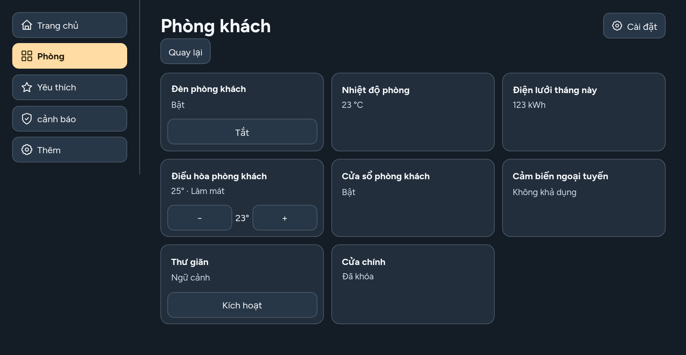

# HomeSmart cho Home Assistant

**Tiếng Việt** · [English](README.md)

HomeSmart thêm một bảng điều khiển vào thanh bên của Home Assistant. Bạn có thể chọn phòng, ghim thiết bị yêu thích và thiết lập các nút điều khiển ngay trên giao diện. HomeSmart lấy danh sách khu vực và thiết bị từ Home Assistant nên bạn không cần viết YAML cho dashboard.

**HomeSmart v2.2.5** bổ sung hồ sơ hiển thị cho từng màn hình. Với cùng một tài khoản, bạn có thể giữ bố cục cổ điển trên máy tính, bật tắt đèn nhanh trên điện thoại và dùng điều khiển từ xa trên TV. Yêu cầu **Home Assistant 2024.7.0 trở lên**. [Ghi chú phát hành](https://github.com/mrtlcs/HomeSmart/releases/tag/v2.2.5) · [Bản mới nhất](https://github.com/mrtlcs/HomeSmart/releases/latest)



*Hồ sơ Máy tính của v2.2.5 với dữ liệu mẫu.* [Xem cùng ngôi nhà trên điện thoại](images/adaptive-phone-vi.png)

## Cài đặt và cập nhật

### Cài qua HACS

1. Mở **HACS → ⋮ → Custom repositories**. Thêm kho `https://github.com/mrtlcs/HomeSmart` và chọn loại **Integration**.
2. Tìm **HomeSmart** trong HACS, chọn **Download**, rồi khởi động lại Home Assistant.
3. Vào **Cài đặt → Thiết bị & dịch vụ → Thêm tích hợp**, chọn **HomeSmart** và xác nhận.
4. Mở **HomeSmart** trên thanh bên. Trong lần đầu sử dụng, làm theo hướng dẫn để chọn các phòng bạn muốn hiển thị.

### Cài thủ công

1. Tải tệp **homesmart.zip** đính kèm bản phát hành. [Tải gói mới nhất](https://github.com/mrtlcs/HomeSmart/releases/latest/download/homesmart.zip)
2. Giải nén **toàn bộ gói** vào `<config>/custom_components/homesmart/`. Bên trong thư mục này, bạn sẽ thấy `manifest.json` nằm cùng cấp với `frontend/`. Giữ đầy đủ nội dung của `frontend/`, kể cả `chunks/` và `fonts/`.
3. Khởi động lại Home Assistant, rồi thêm **HomeSmart** tại **Cài đặt → Thiết bị & dịch vụ → Thêm tích hợp**.

**Nếu bạn đã cài HomeSmart**, hãy cập nhật qua HACS hoặc thay các tệp tích hợp bằng nội dung gói phát hành mới. Sau đó khởi động lại Home Assistant và tải lại bảng điều khiển. Sau khi nâng cấp, HomeSmart tiếp tục mở bố cục cổ điển cho đến khi bạn chọn hồ sơ khác. Danh sách phiên bản trong HomeSmart có liên kết tới từng bản phát hành trên GitHub.

## Chọn giao diện cho từng màn hình

Mở **HomeSmart → Cài đặt → Thiết bị này → Hồ sơ trên màn hình này**, rồi chọn cách hiển thị cho trình duyệt đang dùng.

| Hồ sơ | Cách sử dụng |
| --- | --- |
| Điện thoại | Chuyển mục bằng thanh điều hướng ở cạnh dưới. Chạm tên thiết bị để xem chi tiết hoặc dùng nút ngay trên thẻ để điều khiển nhanh. |
| Tablet treo tường | Xem giờ ngay trên bảng điều khiển. Bạn có thể đặt thời gian chờ để hiện đồng hồ nghỉ và chọn khung giờ dùng tông màu tối hơn. |
| Máy tính | Chuyển mục bằng thanh bên, xem thiết bị theo lưới và mở chi tiết ở cạnh màn hình. |
| TV dùng remote | Các nút lớn và có viền đánh dấu mục đang chọn. Với remote tương thích, dùng phím mũi tên để di chuyển, OK/Enter để chọn và phím quay lại để trở về. Hãy chọn hồ sơ này thủ công cho TV. |
| Tự động | Chọn giao diện điện thoại, tablet treo tường hoặc máy tính dựa trên chiều rộng của bảng điều khiển và việc bạn dùng cảm ứng hay chuột. |
| Dashboard cổ điển | Mở bố cục bạn đã thiết lập, chẳng hạn như Bento, Ảnh, Danh sách hoặc Trẻ em. |

HomeSmart ưu tiên lựa chọn trên trình duyệt đang dùng, sau đó đến mặc định của tài khoản, rồi mới đến mặc định của cả nhà. Chọn **Dùng hồ sơ kế thừa** để dùng các giá trị mặc định đó. Quản trị viên Home Assistant còn có thể chọn các tab hiển thị, tab mở đầu và mật độ thẻ cho từng hồ sơ mới.

## Sử dụng hằng ngày

- **Trang chủ và Phòng.** Từ Trang chủ, bạn có thể bật đèn, chỉnh nhiệt độ hoặc kích hoạt ngữ cảnh bằng các thẻ điều khiển nhanh và mục yêu thích. Mở Phòng để tìm thiết bị theo vị trí. Sau khi bạn bấm nút, giao diện sẽ báo khi Home Assistant nhận lệnh hoặc khi lệnh thất bại.
- **Cảnh báo và kết nối.** Mục Cảnh báo hiển thị riêng các sự kiện an ninh, chẳng hạn cửa sổ đang mở, và các thiết bị mất kết nối. Vào **Thêm** để kiểm tra kết nối với Home Assistant, xem lần đồng bộ gần nhất hoặc làm mới dữ liệu.
- **Các trang chuyên dụng.** Trên điện thoại, tablet treo tường và máy tính, mục **Thêm** có lối vào các trang đã bật như camera, đa phương tiện, sơ đồ tầng, giám sát hệ thống và tab tự tạo. Chọn **Dashboard cổ điển** để mở đầy đủ bố cục cổ điển. [Trang chủ cổ điển](images/home-dashboard.jpg) · [Giám sát hệ thống](images/system-monitor-desktop.jpg)
- **Ước tính tiền điện.** Chọn biểu giá cố định hoặc lũy tiến và gán cảm biến đo **lượng điện lấy từ lưới trong kỳ hóa đơn**. Nếu tính theo tháng, bạn có thể dùng cảm biến Utility Meter của Home Assistant với chu kỳ tháng và đơn vị kWh.
- **Khóa cửa và cấu hình chung.** Trước khi gửi lệnh mở khóa, HomeSmart yêu cầu xác nhận hoặc nhập mã PIN nếu bạn đã đặt mã cho dashboard. Home Assistant quyết định tài khoản nào được điều khiển từng thiết bị. Việc lưu cấu hình chung cần quyền quản trị.

## Khôi phục bố cục

Mở **HomeSmart → Cài đặt → Hệ thống → Lịch sử bố cục** bằng trình duyệt và tài khoản đã dùng để chỉnh sửa. HomeSmart lưu tại đó tối đa mười phiên bản trước của các tab, bố cục và thanh điều hướng. Bạn có thể xem trước tên tab và số thẻ theo kích thước màn hình, rồi chọn phiên bản cần khôi phục. Nếu hai quản trị viên sửa cùng lúc và gặp xung đột khi lưu, người gặp xung đột có thể tải xuống bản nháp trước khi nạp lại cấu hình chung.

## Chạy thử với thiết bị mẫu

Dùng Node.js 22 để chạy dashboard trên máy của bạn với dữ liệu mẫu.

```sh
cd frontend
npm ci
npm run dev
```

Mở địa chỉ mà Vite hiển thị. Trong cùng thư mục, chạy `npm test` để kiểm tra hồi quy và `npm run build` để kiểm tra kiểu TypeScript và đóng gói giao diện.

[Báo lỗi](https://github.com/mrtlcs/HomeSmart/issues) · [Giấy phép MIT](LICENSE)
